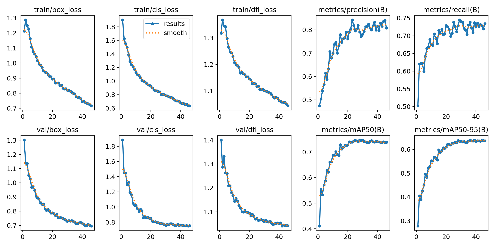
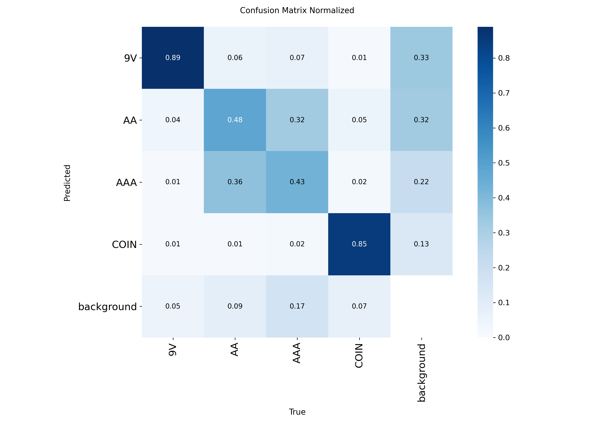

# Project-Battery · VoltScan

YOLOv8 기반으로 배터리의 외형을 탐지하고, 웹캠 영상에서 탐지 결과를 확인하는 Python 데스크톱 프로젝트입니다. 학습 데이터셋, 학습 가중치와 결과, PySide6 기반 UI를 포함합니다.

탐지 클래스는 **`9V`, `AA`, `AAA`, `COIN`** 4종입니다. 배터리의 화학 조성이나 실제 위험도를 판별하는 모델은 아닙니다.

## 주요 기능

- **실시간 탐지**: 기본 웹캠(`VideoCapture(0)`) 영상에 탐지 박스와 클래스 표시
- **모델 선택**: UI에서 학습된 YOLO `.pt` 파일 불러오기
- **스캔 제어**: 실시간 추론 일시정지 및 재개
- **수동 스캔**: 탐지 결과를 화면 내 로그 테이블에 추가
- **데모 화면**: 웹캠을 사용하지 않을 때 합성 스캔 애니메이션 표시

## 프로젝트 구조

```text
Project-Battery/
├── UI/
│   └── scanUI.py                 # VoltScan 데스크톱 UI 및 웹캠 추론
├── model/
│   ├── battery1/                 # 데이터셋: images, labels, data.yaml 등
│   ├── battery2/
│   ├── battery3/
│   ├── battery4/
│   ├── study.py                  # 1차 학습 실험 코드
│   ├── study2.py                 # 후속 학습 실험 코드
│   ├── study3.py
│   ├── study4.py
│   ├── yolov8s.pt                # 사전 학습 가중치
│   └── runs/detect/
│       ├── train/
│       ├── train-2/
│       ├── train-3/
│       └── train-4/              # 각 폴더에 가중치, 지표, 결과 이미지 포함
├── YOLO 배터리 분류 모델 발표 PPT.pdf
└── README.md
```

## 설치 및 실행

Python 환경과 데스크톱 GUI를 실행할 수 있는 환경이 필요합니다. 실제 영상 탐지에는 웹캠도 필요합니다. 저장소에는 의존성 버전을 고정한 파일이 없으므로, 아래 명령으로 필요한 패키지를 설치합니다.

### 1. 저장소 및 가상환경 준비

Windows PowerShell 기준입니다.

```powershell
git clone https://github.com/pjoong4/Project-Battery.git
cd Project-Battery
python -m venv .venv
.\.venv\Scripts\python.exe -m pip install --upgrade pip
.\.venv\Scripts\python.exe -m pip install PySide6 opencv-python numpy ultralytics
```

### 2. UI 실행

프로젝트 루트에서 실행합니다.

```powershell
.\.venv\Scripts\python.exe UI/scanUI.py
```

1. 사이드바의 **YOLO (.pt) 모델 선택** 버튼을 누릅니다.
2. 저장소에 포함된 `model/runs/detect/train-4/weights/best.pt` 등의 학습 가중치를 선택합니다.
3. **카메라 (Webcam) 전환** 버튼을 눌러 웹캠을 활성화합니다.
4. 실시간 탐지 결과를 확인하고, **YOLO 추론 감지 스캔** 버튼으로 탐지 항목을 로그에 추가합니다.
5. **Scanning Active / Paused** 버튼으로 실시간 추론을 제어합니다.

현재 코드의 자동 로드 경로는 `runs/detect/train-11/weights/best.pt`이며, 해당 경로는 저장소에 없습니다. 처음에는 데모 화면으로 시작하므로 위 순서대로 모델을 직접 선택해야 합니다. `model/yolov8s.pt`는 배터리 전용으로 학습한 가중치와 구분해서 사용하세요.

### 데모 표시와 실제 탐지 구분

- 시작 화면의 클래스·신뢰도 및 로그 2개 행은 예시 데이터입니다.
- 수동 스캔은 실제 탐지를 반환하지 못하면 임의의 배터리 종류·신뢰도·위험도 예시를 로그에 추가합니다. 웹캠과 모델이 연결되어 있어도 탐지 결과가 없으면 이 동작이 발생합니다.
- `High (Flammable)` 등의 위험도는 데모 문구이며, 실제 탐지 로그의 위험도 칸에는 `Active Scanned`가 표시됩니다.
- 실시간 추론의 신뢰도 임계값은 `0.3`, 수동 스캔은 `0.25`입니다. 실시간 정보 카드에는 첫 번째 탐지 객체가 표시되며, 수동 스캔도 첫 번째 탐지 결과만 기록합니다.
- `Paused`는 실시간 추론을 멈추며, 수동 스캔 버튼은 별도로 동작합니다.
- 로그는 화면 메모리에만 보관되며, 파일 저장 기능은 구현되어 있지 않습니다.

## 데이터셋

모든 데이터셋의 `data.yaml`에는 동일한 클래스 순서가 정의되어 있습니다.

| 클래스 ID | 이름 |
| --- | --- |
| 0 | 9V |
| 1 | AA |
| 2 | AAA |
| 3 | COIN |

아래 수량은 저장소의 각 `images` 폴더에 포함된 파일 수 기준입니다.

| 데이터셋 | 학습(train) | 검증(valid) | 테스트(test) | 합계 |
| --- | ---: | ---: | ---: | ---: |
| battery1 | 1,558 | 427 | 219 | 2,204 |
| battery2 | 1,200 | 311 | 149 | 1,660 |
| battery3 | 648 | 160 | 80 | 888 |
| battery4 | 10,577 | 930 | 441 | 11,948 |

데이터셋 출처 및 라이선스는 각 폴더의 `data.yaml`, `README.dataset.txt`, `README.roboflow.txt`를 참고하세요. `data.yaml`에 기록된 출처는 다음과 같으며, 라이선스는 모두 **CC BY 4.0**으로 표기되어 있습니다. 이는 데이터셋에 대한 표기입니다.

- [battery1 · Roboflow](https://universe.roboflow.com/s-workspace-zd1is/battery-g0e7j/dataset/1)
- [battery2 · Roboflow](https://universe.roboflow.com/-mceqr/battery-92tmi/dataset/1)
- [battery3 · Roboflow](https://universe.roboflow.com/s-workspace-zd1is/battery_last/dataset/3)
- [battery4 · Roboflow](https://universe.roboflow.com/s-workspace-zd1is/battery_last-2-1/dataset/2)

## 학습 및 재현

`model/study*.py`는 학습 실험 코드입니다. **현재 파일에는 인자 사이 쉼표 누락으로 인한 문법 오류가 있어 그대로 실행할 수 없습니다.** 후속 스크립트의 가중치 경로도 `run/detect/...`로 작성되어 있어 실제 폴더인 `runs/detect/...`와 다릅니다.

새 학습을 시작하려면 다음과 같이 데이터 경로를 명시한 별도 YAML과 CLI를 사용할 수 있습니다. 아래 예시는 기존 실험 결과의 완전한 재현이 아니라 `battery4`로 새 학습을 실행하는 방법입니다.

1. `model/battery4.local.yaml`을 만들고 `path`를 자신의 환경에 맞는 **데이터셋 절대 경로**로 설정합니다. 기존 데이터셋 YAML의 `../train/images` 등의 상대 경로는 사용 환경에서 확인이 필요합니다.

   ```yaml
   path: C:/Users/your-name/Project-Battery/model/battery4
   train: train/images
   val: valid/images
   test: test/images
   nc: 4
   names: ['9V', 'AA', 'AAA', 'COIN']
   ```

2. 프로젝트 루트에서 학습을 실행합니다. 아래 명령은 CPU 기준이며, 실행 시간이 오래 걸릴 수 있습니다.

   ```powershell
   .\.venv\Scripts\yolo.exe detect train model=model/yolov8s.pt data=model/battery4.local.yaml epochs=60 patience=10 imgsz=640 batch=32 device=cpu workers=4 cache=True lr0=0.01 lrf=0.01 close_mosaic=10 project=model/runs/detect name=battery4-new
   ```

   CUDA를 사용할 수 있는 PyTorch 환경에서는 `device=0`으로 GPU를 지정할 수 있습니다. 메모리가 부족하면 `batch`를 줄이거나 `cache=False`로 변경하세요.

학습 결과에는 `weights/best.pt`, `weights/last.pt`, `results.csv`, 혼동 행렬, PR 곡선 및 예측 이미지 등이 저장됩니다. 기존 실험 설정은 각 실행 폴더의 `args.yaml`에 남아 있으나, 당시 로컬 경로와 현재 저장소 경로가 다를 수 있습니다. 예를 들어 `train-4/args.yaml`에는 현재 포함되지 않은 `battery_test/data.yaml`과 실행 이름 `train-11`이 기록되어 있습니다.

## 저장된 학습 결과

아래 값은 각 `results.csv`에서 **검증 mAP50-95가 가장 높은 epoch**의 지표입니다. 테스트셋 성능이 아니며, 실행별 데이터와 설정이 동일하다는 보장은 없어 수치만으로 모델의 우열을 판단하기 어렵습니다.

| 실행 폴더 | 기록된 epoch 수 | 선택 epoch | Precision | Recall | mAP50 | mAP50-95 |
| --- | ---: | ---: | ---: | ---: | ---: | ---: |
| train | 67 | 52 | 0.68173 | 0.81161 | 0.75669 | 0.60777 |
| train-2 | 30 | 30 | 0.82873 | 0.74281 | 0.77269 | 0.62190 |
| train-3 | 23 | 13 | 0.84133 | 0.25127 | 0.25800 | 0.20763 |
| train-4 | 46 | 36 | 0.79982 | 0.73866 | 0.74449 | 0.63933 |





## 문제 해결

| 증상 | 확인 사항 |
| --- | --- |
| 모델을 찾을 수 없다는 메시지 | UI에서 실제 `model/runs/detect/.../weights/best.pt` 파일을 선택합니다. |
| `ultralytics` 미설치 경고 | UI를 실행한 Python 환경에 `ultralytics`를 설치합니다. UI는 해당 패키지 없이도 데모 모드로 실행될 수 있습니다. |
| 웹캠이 열리지 않음 | 카메라 연결, 다른 앱의 카메라 사용 여부, OS 카메라 권한을 확인합니다. 현재 코드는 카메라 인덱스 `0`을 사용합니다. |
| 학습 스크립트에서 `SyntaxError` 발생 | `study*.py`의 쉼표 누락을 수정하거나 위 CLI 예시를 사용합니다. |
| 학습 이미지 경로 오류 | 데이터셋 절대 경로와 `train`, `val`, `test` 경로를 확인합니다. |

## 발표 자료

[YOLO 배터리 분류 모델 발표 PPT (PDF)](YOLO%20배터리%20분류%20모델%20발표%20PPT.pdf)
# 되나?
